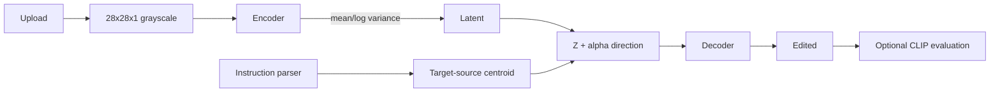
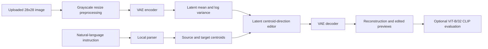

# LatentStyle AI — P38

LatentStyle AI edits Fashion-MNIST clothing images through a TensorFlow 2 Variational Autoencoder (VAE). A local instruction parser identifies source and target Fashion-MNIST classes, then moves the image latent vector toward the target class centroid.

## Features

- Lightweight convolutional VAE with mean, log-variance, reparameterization, reconstruction loss, and KL loss
- Reproducible Fashion-MNIST class centroids
- Reliable local source/target parser with optional editing strength
- Five-step morph-strip generation
- Optional CLIP image-text evaluation
- Gradio upload interface and downloadable edits
- Lightweight GAN comparison architecture and methodology notes

## Installation

```powershell
cd "B:\ClgDoc\4th Year\Sem 7th\Gen AI\Ca Assignment"
py -3.10 -m venv .venv
.venv\Scripts\Activate.ps1
python -m pip install --upgrade pip
pip install -r requirements.txt
```

The main requirements are CPU-compatible and do not install optional CLIP/Torch packages.

Optional CLIP installation:

```powershell
pip install torch torchvision
pip install git+https://github.com/openai/CLIP.git
```
Or use the optional pinned file:

```powershell
pip install -r requirements-clip.txt
```

CLIP requires a separate optional environment addition because ViT-B/32 and Torch use more memory than the base application. It is loaded only when the user enables evaluation. No API key is required.

## Train and Generate Artifacts

```powershell
python scripts/train_vae.py --epochs 20 --batch-size 128 --latent-dim 16
python scripts/compute_centroids.py
python scripts/generate_morphs.py
python scripts/train_gan.py
```

The VAE is intended to be trained once. The application does not retrain or download models at startup.

## Run the Application

```powershell
python app/app.py
```

Open the local Gradio URL printed by the application. The application defaults to port `10000`; set `PORT` to override it.

## Example Instructions

- `Make this sneaker look more like a sandal.`
- `Change this shirt into a coat.`
- `Make this ankle boot resemble a sneaker.`
- Add `alpha=0.5` or set the strength slider to configure movement.

## Editing Method

For latent vector \(z_s\) and source/target centroid vectors \(c_s, c_t\):

\[
z_{edited}=z_s+\alpha(c_t-c_s)
\]

The decoder reconstructs the edited vector. This is geometric latent movement, not guaranteed semantic transformation.

## Testing

```powershell
python -m pytest -q
```

Current measured test result: **18 passed in 11.03 seconds**.

Tests cover parser aliases, source/target transitions, alpha values, centroid loading, preprocessing, VAE forward/reconstruction shape, morph generation, disabled CLIP behavior, real-model Sneaker-to-Sandal editing, and Gradio startup imports.

## Architecture



## CLIP Evaluation

CLIP is loaded only when the user enables it. If package loading or hardware initialization fails, the application reports the failure and never substitutes fabricated scores. Because CLIP is trained primarily on natural images, grayscale 28x28 Fashion-MNIST is outside its ideal domain.

## GAN Comparison

The included generator is a lightweight DCGAN-style 28x28 comparison baseline. A GAN is trained to produce samples from a data distribution through generator/discriminator adversarial objectives; it does not provide the VAE’s explicit encoder-based latent inference or centroid coordinates. Moving along a centroid direction is therefore natural for a VAE but would require additional representation work for a GAN.

## Limitations

- Fashion-MNIST resolution is only 28x28.
- Grayscale images lack color and texture cues.
- Class semantics are limited and overlapping (shirt, pullover, coat).
- A VAE latent space may be imperfectly disentangled.
- Centroid directions are averages and do not guarantee one target class attribute.
- Arbitrary real-world clothing photos may preprocess poorly.
- VAE samples may be blurry; GANs may be unstable and less controllable.
- CLIP domain mismatch can reduce score reliability.
- Generated and real-world clothing distributions differ substantially.

## Render Deployment

1. Push this project to a repository after reviewing the model artifacts and secrets.
2. Create a Render Web Service using `render.yaml`, or configure:
   - Build: `pip install -r requirements.txt`
   - Start: `python app/app.py`
3. Ensure the required VAE and centroid artifact are included or restored before startup.
4. Use only CPU-compatible settings and verify the deployed URL.

The project pins the Render runtime to Python 3.11 through the repository-root `.python-version` file and `PYTHON_VERSION=3.11.11`. Python 3.11 is required because this avoids unsupported Python 3.14 environments for the pinned TensorFlow package. TensorFlow and the trained model artifact are loaded from the repository; the application does not retrain during startup.

The application listens on `0.0.0.0` and reads `PORT` from the environment, defaulting to `10000` locally.

## Academic Report Support

The experiment log should record dataset size, epochs, latent dimension, loss curves, reconstruction images, centroid counts, morph grids, and hardware. Failure cases and measured results must be reported separately from expected outcomes.

## Submission Placeholders

- GitHub URL: https://github.com/priyanshgolwalkar/LatentStyle-AI
- Live application URL: `TBD`
- Demo video URL: `TBD`

## Project Screenshots

No manually captured application screenshots were present in the workspace at publication audit time. The submission checklist identifies the screenshots required before final defense. Generated model visualizations are preserved in:

- [Reconstruction Grid](outputs/reconstructions/reconstruction_grid.png)
- [Sneaker to Sandal Morph](outputs/morph_strips/Sneaker_to_Sandal.png)
- [Shirt to Coat Morph](outputs/morph_strips/Shirt_to_Coat.png)
- [Bag to Dress Morph](outputs/morph_strips/Bag_to_Dress.png)
- [Ankle Boot to Sneaker Morph](outputs/morph_strips/Ankle%20boot_to_Sneaker.png)
- [T-shirt to Pullover Morph](outputs/morph_strips/T-shirt-top_to_Pullover.png)

## Measured Experiment Results

The VAE development run used a latent dimension of 16, batch size 128, and 3 epochs. Final values were:

- Training loss: `248.395126`
- Reconstruction loss: `234.493545`
- KL loss: `13.901587`
- Validation loss: `230.025879`
- Validation reconstruction loss: `215.915863`
- Validation KL loss: `14.110016`

These are a short development run, not a claim of optimal convergence. The output quality can improve with longer training.

Real Sneaker-to-Sandal edit measurements:

- Latent movement: `1.6640`
- ViT-B/32 original source similarity: `0.2626797259`
- ViT-B/32 original target similarity: `0.2630435228`
- ViT-B/32 edited source similarity: `0.2813825607`
- ViT-B/32 edited target similarity: `0.2845023572`
- Result reported target-aligned: `Yes`

## Architecture

See [VAE Architecture](docs/vae_architecture.md) and [Architecture Diagram](docs/architecture.md).


